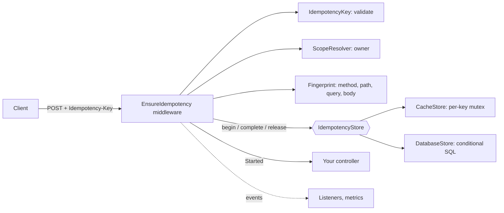
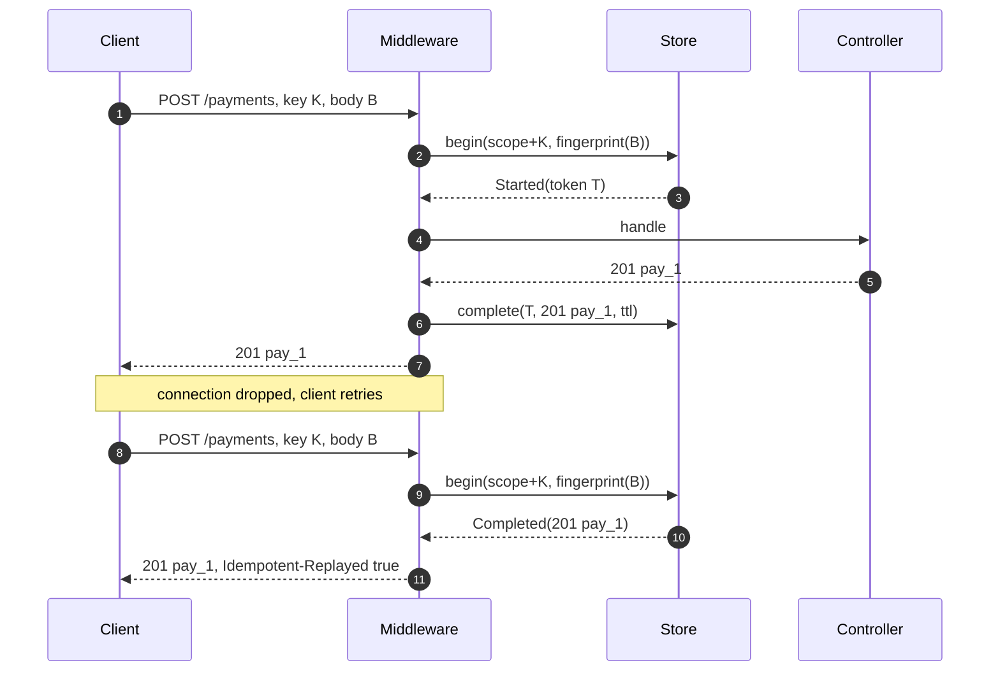
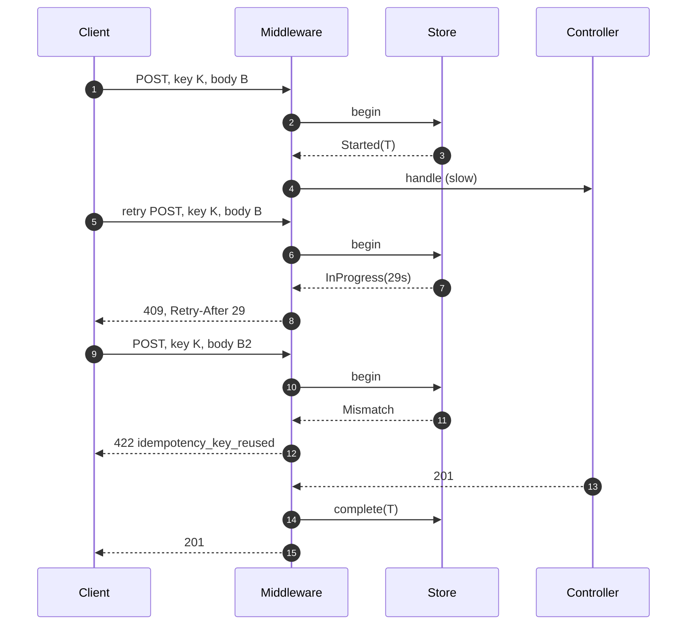
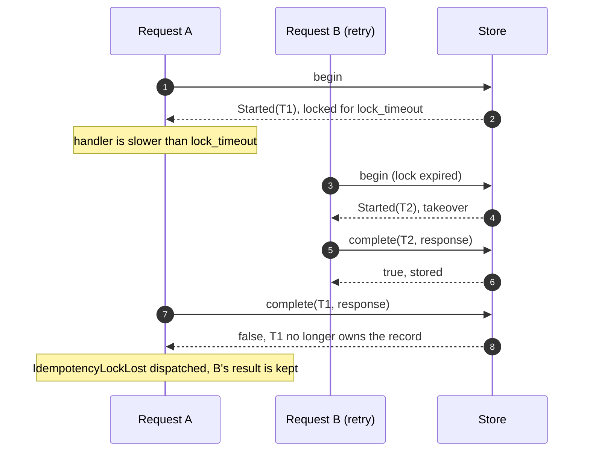

# Laravel Idempotency

[](https://github.com/azhimov/laravel-idempotency/actions/workflows/ci.yml)
[](https://packagist.org/packages/azhimov/laravel-idempotency)
[](https://packagist.org/packages/azhimov/laravel-idempotency)
[](LICENSE)

`Idempotency-Key` middleware for Laravel: a retried `POST` / `PATCH` is executed **once**, and every retry gets the original response back.
Designed with payment APIs in mind: request fingerprinting, real concurrency control, fencing when a lock expires and an optional database store that does not depend on Redis.
It makes duplicate execution much less likely; it does **not** make it impossible — see [Limitations](#limitations).

## The problem

A client sends `POST /payments`. The payment goes through, but the connection drops before the response arrives. The client retries — and the customer is charged twice.

The standard fix (Stripe, Adyen, the IETF draft [*The Idempotency-Key HTTP Header Field*](https://datatracker.ietf.org/doc/draft-ietf-httpapi-idempotency-key-header/)): the client sends a unique `Idempotency-Key` with the request, the server performs the operation once and answers every retry with the stored response.

## Installation

Requires PHP 8.2+ and Laravel 11, 12 or 13.

```bash
composer require azhimov/laravel-idempotency
```

The service provider is auto-discovered. Optionally publish the config:

```bash
php artisan vendor:publish --tag=idempotency-config
```

## Quick start

Add the `idempotent` middleware to the routes that create or change things. Put your auth middleware **before** it, so keys are scoped per user.

```php
// routes/api.php
Route::post('/payments', [PaymentController::class, 'store'])
    ->middleware(['auth:sanctum', 'idempotent']);
```

That's it. The client generates a key (a UUID is fine) per operation and reuses it for retries:

```bash
curl -i -X POST https://api.example.test/api/payments \
  -H 'Content-Type: application/json' \
  -H 'Idempotency-Key: 5d0b7e7a-3c55-4b2e-9a39-1f0a3c2d9e41' \
  -d '{"amount":1500,"currency":"KZT"}'
```
```http
HTTP/1.1 201 Created

{"id":"pay_lym5etgj","amount":1500,"currency":"KZT","status":"succeeded"}
```

Send exactly the same request again — the controller is **not** called, the stored response is replayed:

```http
HTTP/1.1 201 Created
Idempotent-Replayed: true

{"id":"pay_lym5etgj","amount":1500,"currency":"KZT","status":"succeeded"}
```

Same key, different body — rejected:

```bash
curl -i -X POST https://api.example.test/api/payments \
  -H 'Content-Type: application/json' \
  -H 'Idempotency-Key: 5d0b7e7a-3c55-4b2e-9a39-1f0a3c2d9e41' \
  -d '{"amount":9999,"currency":"KZT"}'
```
```http
HTTP/1.1 422 Unprocessable Content

{"error":{"code":"idempotency_key_reused","message":"This idempotency key was already used with a different request."}}
```

A retry that arrives while the first request is still running:

```http
HTTP/1.1 409 Conflict
Retry-After: 29

{"error":{"code":"idempotency_request_in_progress","message":"A request with this idempotency key is still being processed. Retry later."}}
```

> The examples above are real outputs from a fresh Laravel 13 app with this package installed.

### Per-route options

```php
->middleware('idempotent:required')          // 400 without a key
->middleware('idempotent:ttl=3600')          // keep responses for 1 hour on this route
->middleware('idempotent:required,ttl=600')  // both
->middleware('idempotent:optional')          // override a global 'required' => true
```

An unknown option throws — a typo like `idempotent:requird` must never silently disable protection.

## Responses

| Situation | Status | `error.code` | Handler runs? |
|---|---|---|---|
| First request with a key | handler's | — | yes |
| Same key + same request, finished | stored status, `Idempotent-Replayed: true` | — | **no** |
| Same key + same request, still running | **409** + `Retry-After` | `idempotency_request_in_progress` | no |
| Same key + different request | **422** | `idempotency_key_reused` | no |
| No key, route `required` | **400** | `idempotency_key_missing` | no |
| Empty, too long or non-ASCII key | **400** | `idempotency_key_invalid` | no |
| No key, route optional | handler's | — | yes, without protection |
| Method not in `methods` (e.g. `GET`) | handler's | — | yes, untouched |

What gets stored and replayed:

| Handler outcome | Stored? | What a retry does |
|---|---|---|
| 2xx, 3xx, 4xx | yes, for `ttl` | gets the stored response (a `303` redirect is replayed as `303`) |
| **5xx** | no, the key is released | executes again |
| Exception | no, the key is released | executes again |
| Streamed or file response | no, the key is released | executes again |

## Configuration

`config/idempotency.php` (defaults). `store`, `ttl` and `required` can also be set from `.env`; malformed values fail loudly instead of falling back:

| Key | Default | Meaning |
|---|---|---|
| `header` | `Idempotency-Key` | Request header with the key |
| `methods` | `['POST', 'PATCH']` | Protected methods; others pass through |
| `required` | `false` | Reject requests without a key (per route: `idempotent:required`). Env: `IDEMPOTENCY_REQUIRED` |
| `ttl` | `86400` | Seconds a response is replayed (per route: `idempotent:ttl=N`). Env: `IDEMPOTENCY_TTL` |
| `lock_timeout` | `30` | Seconds a running request holds the key. **Must exceed your slowest handler** |
| `store` | `cache` | `cache`, `database` or a class implementing `IdempotencyStore`. Env: `IDEMPOTENCY_STORE` |
| `cache_store` | `null` | Cache store for `cache` (must support atomic locks); `null` = default |
| `database.connection` / `.table` | `null` / `idempotency_keys` | For the `database` store |
| `replay_header` | `Idempotent-Replayed` | Header added to replays |
| `store_status_codes` | `[[200, 499]]` | Inclusive ranges that are stored (2xx, 3xx, 4xx); ranges ≥ 500 are rejected |
| `replay_headers` | `['Content-Type', 'Location']` | Response headers stored and replayed (never `Set-Cookie` unless you add it) |
| `scope_resolver` | `UserScopeResolver` | Who owns a key |
| `error_responder` | `JsonErrorResponder` | Renders 400/409/422 |
| `max_key_length` | `255` | Longest accepted key |

### Choosing a store

| | `cache` (default) | `database` |
|---|---|---|
| Needs | cache store with atomic locks (Redis recommended) | a table (migration included) |
| Speed | fastest | one indexed row per request |
| Survives cache eviction / Redis restart | **no** — an evicted key means a retry runs again | **yes** |
| Exactly-once execution | no (see [Limitations](#limitations)) | no (see [Limitations](#limitations)) |
| Cleanup | automatic (cache TTL) | `php artisan idempotency:purge` |
| Use for | general APIs | operations where a lost key is unacceptable (payments, payouts) |

```bash
php artisan vendor:publish --tag=idempotency-migrations
php artisan migrate
```

```php
// config/idempotency.php
'store' => 'database',

// routes/console.php
Schedule::command('idempotency:purge')->hourly();
```

#### Use a separate database connection

Point the store at its **own connection** (same database, separate PDO):

```php
// config/database.php — a copy of your main connection under a new name
'connections' => [
    'idempotency' => [
        'driver' => 'pgsql',
        'host' => env('DB_HOST', '127.0.0.1'),
        'port' => env('DB_PORT', '5432'),
        'database' => env('DB_DATABASE', 'laravel'),
        'username' => env('DB_USERNAME', 'root'),
        'password' => env('DB_PASSWORD', ''),
        // ... same options as your main connection
    ],
],

// config/idempotency.php
'database' => ['connection' => 'idempotency', 'table' => 'idempotency_keys'],
```

Why: if the store shares the connection your application uses and a transaction is open on it while the middleware runs (a `DB::transaction()` around the request, a package that wraps requests in transactions, `RefreshDatabase` in tests), the claim and the stored response become part of *your* transaction. Other requests don't see the claim until commit (or block on the uncommitted row), and a rollback silently erases it. On a separate connection every claim and completion is committed immediately and is visible to all workers.

### Scoping keys (users, API clients, tenants)

A key is scoped by **owner + HTTP method + route template**, so the same key from two users, or on two different endpoints, never collides.
The default `UserScopeResolver` uses the authenticated user's model class and id, and the client IP for guests.

For API clients or tenants, implement the contract:

```php
use Azhimov\Idempotency\Contracts\ScopeResolver;
use Illuminate\Http\Request;

final class TenantScopeResolver implements ScopeResolver
{
    public function resolve(Request $request): string
    {
        return 'tenant:'.$request->attributes->get('tenant_id').':user:'.$request->user()?->getAuthIdentifier();
    }
}
```

```php
'scope_resolver' => App\Idempotency\TenantScopeResolver::class,
```

### Custom error format

Implement `Azhimov\Idempotency\Contracts\ErrorResponder` and set `error_responder`. The middleware adds `Retry-After` to 409 itself.

```php
final class ProblemJsonResponder implements ErrorResponder
{
    public function respond(Request $request, ErrorCode $code, string $message): Response
    {
        return response()->json(['type' => $code->value, 'detail' => $message], $code->status(), [
            'Content-Type' => 'application/problem+json',
        ]);
    }
}
```

## Events

Listen to them for metrics, logs and alerts. Every event has `$request` and `$key` (the client key).

| Event | When | Extra |
|---|---|---|
| `IdempotentRequestStarted` | key claimed, handler about to run | |
| `IdempotentResponseStored` | response stored for replay | `$status` |
| `IdempotentResponseReplayed` | stored response replayed | `$status` |
| `IdempotencyKeyMismatch` | 422, key reused with another request | |
| `IdempotencyConflict` | 409, same request still running | `$retryAfter` |
| `IdempotencyLockLost` | handler finished after its claim expired and another request took the key over — **the operation may have run twice** | `$status` |

`IdempotencyLockLost` should page someone: it means `lock_timeout` is shorter than a real handler.

## How it works



The store owns the lock. `begin()` atomically returns one of `Started(token)`, `InProgress(retryAfter)`, `Completed(response)` or `Mismatch`; `complete()` and `release()` only act while the caller still owns the record.

### First request and replay



### Concurrent retry and reused key



### Lock expiry and fencing



## Why it's built this way

- **The store owns the lock.** No separate `Cache::lock` held around your controller: claiming the key *is* the lock. This lets the database store work without Redis at all.
- **Owner tokens (fencing).** Every claim gets a fresh token; `complete()` is compare-and-set on it. A request whose lock expired can't overwrite the result of the request that took over — and you get `IdempotencyLockLost` instead of silent corruption.
- **Durable keys in the database store.** Records are rows, so a cache eviction or a Redis restart can't erase a key and let a retry through. That closes one source of duplicates, not all of them (see [Limitations](#limitations)). The claim is a primary-key `insertOrIgnore` (no exception, so it never aborts a surrounding PostgreSQL transaction); takeover, complete and release are single conditional `UPDATE`/`DELETE` statements.
- **Cache store is atomic too.** Every state transition runs as read-modify-write under a short per-key cache lock, not just the first `add`.
- **Strict fingerprint.** JSON key order, whitespace and form/query parameter order are ignored; values, value types (`1500` vs `"1500"`), list order and uploaded file contents are not. A false 422 is better than replaying a response for a different payment.
- **Safe defaults.** 5xx is never stored (and can't be configured to be); guests are scoped by IP, never share one namespace; only whitelisted headers are replayed (no `Set-Cookie` leaks between retries).
- **A storage error never hides the real result.** If storing the response fails *after* the operation ran, the client still gets the real response (the error is reported); the claim stays until `lock_timeout`, so retries get 409 instead of running immediately — but after `lock_timeout` a retry takes the key over and runs again (see [Limitations](#limitations)).

## Comparison with alternatives

Checked on Packagist on 2026-11-11. All of these are solid; pick by what you need.

| | **this package** | [square1/laravel-idempotency](https://github.com/square1-io/laravel-idempotency) | [wendelladriel/laravel-idempotency](https://github.com/WendellAdriel/laravel-idempotency) | [infinitypaul/idempotency-laravel](https://github.com/infinitypaul/idempotency-laravel) | [grazulex/laravel-api-idempotency](https://github.com/Grazulex/laravel-api-idempotency) |
|---|---|---|---|---|---|
| Downloads | new | ~308k | ~41k | ~40k | ~1k |
| Laravel | 11–13 | 12–13 | 13 | 9–13 | 12–13 |
| Lock against concurrent execution | ✅ 409 + `Retry-After` | ✅ 409 | ✅ | ✅ | ✅ wait / reject |
| Payload fingerprint | ✅ 422 | ✅ 422 | replays same data only¹ | ✅ | ✅ |
| Database store | ✅ | cache only | cache only | ¹ | ✅ (+ Redis, DynamoDB) |
| Lock expiry fencing (owner token) | ✅ | documented caveat | ¹ | ¹ | ¹ |
| 5xx stored by default | **no** (can't be enabled) | yes (configurable) | yes (configurable) | ¹ | ¹ |
| Events | ✅ 6 | ¹ | ¹ | telemetry + alerts | ✅ |
| Scope | custom resolver | user / ip / global | enum (e.g. ip) | ¹ | user / tenant / ip / custom |
| Extras this package doesn't have | | throw-instead-of-replay mode | key from form input `_idempotency_key` | Inspector telemetry, alert thresholds | DynamoDB, test assertions |

¹ Not described in the package's README at the time of writing — it may exist; corrections welcome.

## Limitations

- **The window between your business change and `complete()`.** The response is stored *after* your controller returns. If the process dies in between (OOM kill, deploy, server crash), or the store is unavailable at that moment, the operation has happened but its result is not recorded. The key stays claimed until `lock_timeout` (retries get 409), then a retry takes it over and **runs the handler again**. Neither store closes this window in v0.1: the business change and the idempotency record are written in separate transactions. Until [v0.2](#roadmap), mitigate it at the domain level — a unique constraint on a business key (e.g. `payments.client_reference`) so a second execution fails instead of charging twice — keep handlers short, and alert on `IdempotencyLockLost` and on errors reported from the middleware.
- **`lock_timeout` must be longer than your slowest handler.** Otherwise a retry can take the key over while the first request is still running (you'll see `IdempotencyLockLost`).
- **Guests are scoped by IP.** Clients behind one NAT share it; prefer `idempotent:required` on authenticated routes. Make sure `TrustProxies` is configured so `$request->ip()` is the real client.
- **Streamed and file responses** can't be captured; the key is released and a retry runs again.
- **The cache store can lose keys** under memory pressure or on a Redis restart; a lost key lets the next retry run again. Prefer the database store where that matters.
- **The database store shares your transaction** if it uses your application's connection — use a [separate connection](#use-a-separate-database-connection).

## Roadmap

- **v0.2 — `DatabaseStore::completeInTransaction()`**: an opt-in way to store the response in the *same* database transaction as the business change (the store and your models on one connection), so the result is committed atomically with the operation. This closes the window described in [Limitations](#limitations) for database-backed operations.

## Testing

```bash
composer check   # Pint, Larastan (level max), Pest
```

Every store must pass the shared contract suite in [`tests/Support/StoreContract.php`](tests/Support/StoreContract.php) — use it for your own `IdempotencyStore` implementation.

## Changelog

See [CHANGELOG.md](CHANGELOG.md).

## License

MIT. See [LICENSE](LICENSE).
